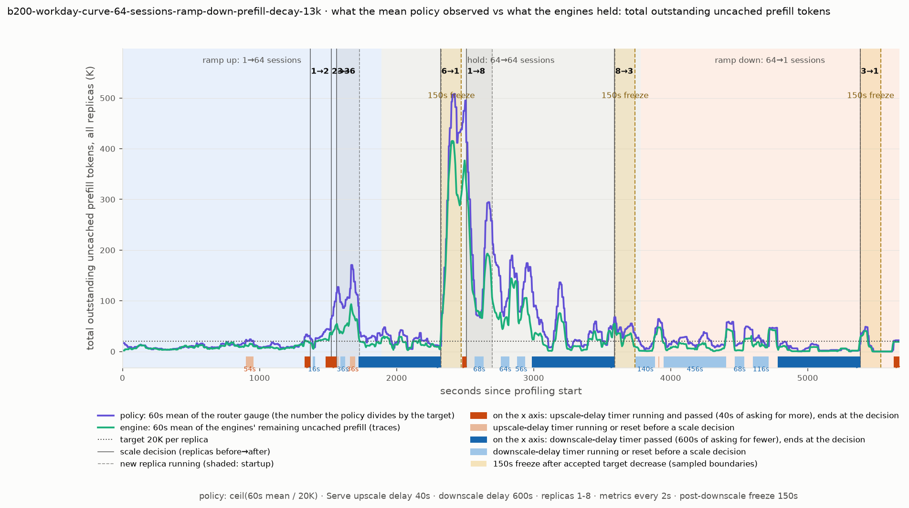
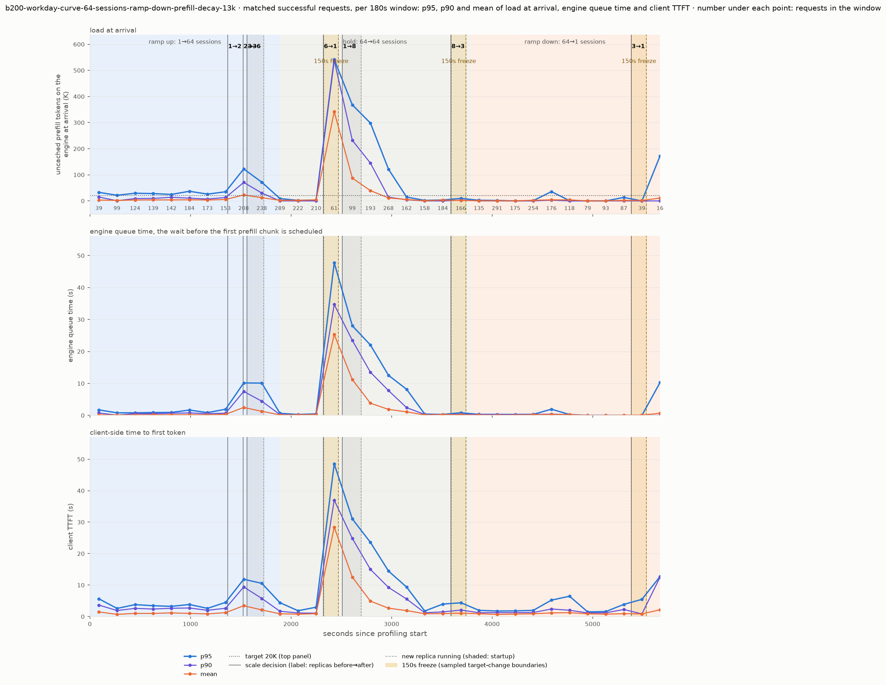
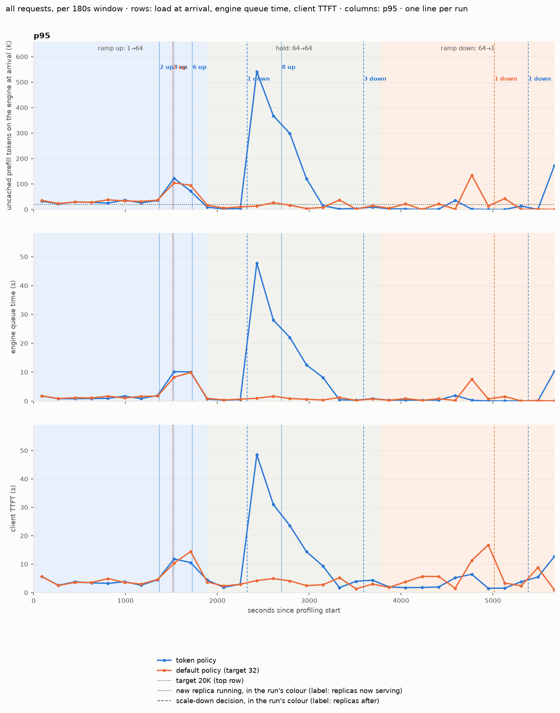

# Serve LLM autoscaling harness

A tool for answering one question: **does this autoscaling policy serve this
workload better than that one, and at what GPU cost?**

One command deploys a Ray Serve LLM application, replays a workload whose
number of concurrent agent sessions ramps up, holds and ramps down, records
what the autoscaler saw and did, and writes a scorecard and two plots. You
run it once per policy variant and compare the runs.

```bash
autoscale-harness run experiments/b200_token_64_sessions.yaml              # policy A
autoscale-harness run experiments/b200_default_target32_64_sessions.yaml   # policy B
autoscale-harness compare runs/<run A> runs/<run B>
```

Contents: [Quick start](#quick-start) · [What you get](#what-you-get-from-a-run) ·
[Comparing runs](#comparing-two-runs) · [Evaluating your own policy](#evaluating-your-own-policy-change) ·
[Config reference](#config-reference) · [Commands](#commands) ·
[When something looks wrong](#when-something-looks-wrong) · [Code map](#code-map)

## Quick start

You need a Ray cluster with GPUs (developed on an Anyscale workspace with
8x B200) and about 20 minutes for the first three steps.

**1. Set up the environment.** Follow [SETUP.md](SETUP.md) once per
workspace, and re-run its checks after every workspace restart. It installs
the harness, the pinned Ray branch that contains the token policy, and one
vLLM patch. Nothing below works without it.

**2. Confirm the harness sees the cluster.**

```bash
cd serve-llm-autoscaling-experiment
autoscale-harness check
```

It prints the Python, Ray and AIPerf versions and the cluster's resources,
and fails if there is no GPU.

**3. Warm the compile caches** (about 5 minutes the first time):

```bash
autoscale-harness warm experiments/smoke.yaml
```

This starts one replica on every GPU so each has a compiled model cached,
then shuts them down. Without it, the first replica to land on each GPU
takes about 80 seconds longer to start, which makes scale-up times
incomparable between runs. Repeat it only when you change
`deployment.engine` settings or the vLLM version.

**4. Run the ten-minute smoke test.**

```bash
autoscale-harness run experiments/smoke.yaml
```

It should end with a scorecard and `Run artifacts: runs/<timestamp>-smoke`.
If it does, the whole path works: deploy, workload, telemetry, analysis,
plots, teardown.

**5. Run a real experiment** (a 64-session run takes about 1h45m):

```bash
autoscale-harness run experiments/b200_token_64_sessions.yaml
```

**6. Look at the results.** The scorecard is printed at the end. The plots
are in `runs/<timestamp>-<name>/analysis/`; open `index.html` there to see
both on one page. The next section explains how to read them.

### The experiments provided

| Config | Policy | Workload |
|---|---|---|
| `smoke.yaml` | token | 1 → 8 → 2 sessions in 8 minutes; checks the harness, not a policy |
| `b200_token_32_sessions.yaml` | token | 1 → 32 → 1 sessions, 47 minutes |
| `b200_token_64_sessions.yaml` | token | 1 → 64 → 1 sessions, 95 minutes |
| `b200_token_100_sessions.yaml` | token | 1 → 100 → 1 sessions, 149 minutes |
| `b200_default_target12_64_sessions.yaml` | Serve default, `target_ongoing_requests: 12` | same as the 64-session token run |
| `b200_default_target32_64_sessions.yaml` | Serve default, `target_ongoing_requests: 32` | same as the 64-session token run |

Every curve adds one session every 30 seconds, holds at the peak for as long
as the ramp took, then removes one every 30 seconds. All share one seed, so
the same sessions start at the same times in every run of a curve.

## What a run does

1. **Checks** the config against the installed Ray: the router and policy
   import, and the policy accepts the configured kwargs. A mismatch stops
   the run here, in seconds.
2. **Deploys** the application described under `deployment`, with the
   harness's tracing scheduler injected into every vLLM engine (see
   [Code map](#code-map)).
3. **Replays the workload** with AIPerf while sampling Serve's replica
   states every second and the policy's signal every two seconds.
4. **Observes** the idle deployment for `post_load_observation_s`, to see
   scale-down after load ends.
5. **Analyzes** the run and writes the outputs below.
6. **Tears down** the application (unless `--keep-deployment`).

## What you get from a run

Three things: a scorecard and two plots. The examples below are from a
64-session token-policy run on 8x B200 (2026-11-17).

### 1. The scorecard

Printed at the end of the run and saved as
`analysis/autoscaling_evaluation.json`.

```text
=== Autoscaling evaluation: policy token, steady state 0-5670s, 5082 requests (106 failed): SLO FAIL ===
TTFT: p95 9261ms vs SLO 5000ms: FAIL · 91% of requests within · mean 1939ms, within SLO 90% of the time (565s over)
ITL : p95 70ms vs SLO 50ms: FAIL · 87% of requests within · mean 29ms, within SLO 88% of the time (680s over)
TTFT by prompt: warm p95 8025ms (4400 requests) · cold (<50% cached) p95 14521ms (576 requests)
GPU time: 5.78 GPU-h during load · 18613 replica-s running (mean 3.3, max 8), 2205 replica-s starting
Scaling: 5 up / 3 down · first up at 1371s · upscale lag mean 172s, max 188s
TTFT p95 9261ms = own prefill 1809ms + waiting 7452ms · with instant replica startup 6567ms (346 requests started during a startup)
```

| Line | How to read it |
|---|---|
| **TTFT / ITL** | Time to first token and inter-token latency against the targets in `analysis`. PASS means the p95 request was within target. "Within SLO N% of the time" is the share of 30-second windows whose mean met the target. |
| **TTFT by prompt** | Warm prompts were mostly read from cache; cold ones (under half cached) pay seconds of prefill at any replica count. The warm figure is the one autoscaling can move. |
| **GPU time** | What the policy cost: GPU-hours while load was offered, and mean and peak replicas. Any policy meets the SLO at `max_replicas`, so always read latency next to this line. |
| **Scaling** | How many scale-ups and scale-downs, when the first scale-up happened, and upscale lag: the time from the decision to the new replica serving. |
| **TTFT p95 = ...** | Splits the p95 into the request's own prefill and time spent waiting, and estimates what it would have been if replicas started instantly. |

### 2. Policy vs engine plot

`analysis/policy_vs_engine_mean<lookback>_<start>_<end>.png` answers: *did
the signal the policy scaled on track the real load, and why did each scale
decision happen when it did?*



- **Purple line**: what the policy saw. The look-back mean of outstanding
  uncached prefill tokens reported by the router; the policy divides this by
  the per-replica target (dotted line) to get the replicas it wants.
- **Green line**: what the engines really held. The same quantity rebuilt
  from the vLLM scheduler traces. Where purple sits far above green, the
  router is over-estimating the work left.
- **Vertical lines**: each scale decision, labelled `before→after`. The grey
  band after a scale-up is the new replica starting; the dashed line is when
  it was running.
- **Bars on the x axis**: the upscale (orange) and downscale (blue) delay
  timers. Dark means the timer ran its full delay and produced the decision;
  light means it was running or was reset.
- **Yellow bands**: the post-downscale freeze, when the policy holds the
  replica count.
- **Background tint**: ramp up (blue), hold (grey), ramp down (peach).

In this example the policy scaled 6→1 during the hold, the backlog spiked to
500K tokens, and it scaled straight back to 8: the kind of behaviour this
plot is for finding.

### 3. Arrival statistics plot

`analysis/arrival_stats_stack180_<start>_<end>.png` answers: *what did
requests experience through each phase, and around each scale event?*



Each point is one 180-second window; the lines are the p95, p90 and mean
over the requests that started in it. The number under each point in the top
panel is how many requests that is.

- **Top**: uncached prefill tokens already queued on the engine when the
  request arrived. This is the load the token policy tries to keep near its
  target (dotted line).
- **Middle**: engine queue time, the wait before the request's first prefill
  chunk was scheduled.
- **Bottom**: client time to first token, what the user felt.

The three panels usually move together: load at arrival drives queue time,
which drives TTFT.

### Everything else in a run directory

```text
runs/<timestamp>-<name>/
├── input.yaml, resolved.yaml   the config as given and as resolved
├── manifest.json               status, versions, timings, warnings
├── deployment/                 what was deployed, and the routing and policy checks
├── benchmark/
│   ├── agentx-concurrency-ramp/  raw AIPerf output (profile_export.jsonl = one record per request)
│   ├── lifecycle.json          when load, drain and idle started and ended
│   └── sweep_summary.json      AIPerf's aggregate metrics
├── telemetry/                  raw samples, never modified by analysis
│   ├── serve_status.jsonl      replica states, every 1s
│   ├── serve_metrics.jsonl     the policy's signal and target replicas, every 2s
│   ├── gpu_kv_events.jsonl     debug log of GPU KV-cache block events (not used by the analysis)
│   └── scheduler-traces/       one vLLM scheduler trace per engine
└── analysis/                   derived; regenerate any time with `autoscale-harness analyze`
    ├── autoscaling_evaluation.json   the scorecard
    ├── policy_vs_engine_mean*.png
    ├── arrival_stats_stack180_*.png
    ├── load_requests.csv       per-request engine data behind the plots
    ├── plot_data.json, request_timeseries.json, concurrency_qps.json
    └── index.html              both plots on one page
```

`runs/` is for local results; do not commit it. The raw files under
`telemetry/` and `benchmark/` are large (2-9 GB for a 64-session run) and are
what `analyze` needs, so keep them as long as you may want to re-analyze.

## Comparing two runs

```bash
autoscale-harness compare runs/<token run> runs/<default run> \
    --labels "token policy;default policy (target 32)" --cols p95 --window 180
```

prints one scorecard row per run:

```text
run                          policy  SLO  TTFT pN  ITL pN TTFT req ITL req TTFT mean ITL mean failed  GPU-h mean max up/down 1st up   lag
20261117T002452Z-...-token    token FAIL   9261ms    70ms      91%     87%    1939ms     29ms    106   5.78  3.3   8     5/3  1371s  172s
20261117T225619Z-...-default default FAIL   4454ms    60ms      96%     91%    1155ms     31ms     25   2.59  1.6   2     1/1  1353s  161s
```

and writes one plot with a line per run, beside the first run directory
(or to `--out`):



The rows are the same three quantities as the arrival statistics plot.
Solid vertical lines mark a new replica serving and dashed lines a
scale-down decision, each in its run's colour and labelled with the replica
count after it. `--cols` picks which of `mean,p90,p95` to draw; without it
you get all three side by side.

Only compare runs of the same workload and seed; then the same sessions
arrive at the same times in both, and differences come from the policy.

## Evaluating your own policy change

1. **Pick the baseline** run to beat, for example
   `b200_token_64_sessions.yaml`, and run it (or reuse an existing run of
   it from the same Ray commit).
2. **Copy its config** and change only `deployment.autoscaling`. Leave the
   workload, engine and seed alone.
3. **Make the change**, in one of three ways:
   - *Different settings of an existing policy*: edit `kwargs` or the delays
     in the copied config.
   - *A modified token policy*: edit it in the Ray checkout
     (`/mnt/local_storage/ray`, see [SETUP.md](SETUP.md#3-ray-branch)), and
     pass any new kwargs in the config. The harness rejects kwargs the
     checked-out policy does not accept.
   - *A new policy*: point the config at it.

     ```yaml
     autoscaling:
       policy:
         name: my-policy                       # label used in outputs
         policy_function: my_module:MyPolicy   # must be importable by the Serve controller
         scope: application                    # or deployment (the default)
         kwargs: {...}
     ```

     A `deployment` policy receives the LLM server's `AutoscalingContext`. An
     `application` policy receives every deployment's context, including the
     load the router reports, and returns a replica count per deployment;
     the token policy is one.
4. **Check it resolves**: `autoscale-harness validate experiments/<yours>.yaml`.
5. **Run it**, then `autoscale-harness compare runs/<baseline> runs/<yours>`.
6. **Judge it** on latency and GPU-hours together, and open the policy vs
   engine plot of your run to see why it scaled when it did.

## Config reference

One YAML file with four sections. Unknown keys are rejected, so a typo is an
error rather than a silently ignored setting.
[`experiments/b200_token_64_sessions.yaml`](experiments/b200_token_64_sessions.yaml)
is the annotated reference.

```yaml
name: b200-token-64-sessions
deployment:            # the Ray Serve LLM application
  model_id: Qwen/Qwen3.6-27B-FP8
  accelerator_type: B200
  routing:
    policy: kv_aware
    haproxy_request_buffer_bytes: 8388608
  engine: {...}
  autoscaling:
    policy:
      name: token
      kwargs: {target_prefill_tokens_per_replica: 20000, post_downscale_cooldown_s: 150}
    min_replicas: 1
    initial_replicas: 1
    max_replicas: 8
    upscale_delay_s: 40
    downscale_delay_s: 600
    look_back_period_s: 60
benchmark:             # the workload
  duration_s: 5670
  grace_period_s: 120
  post_load_observation_s: 180
  workload:
    concurrency_series:
      - {time_s: 0, sessions: 1}
      - {time_s: 1890, sessions: 64}
      - {time_s: 3780, sessions: 64}
      - {time_s: 5670, sessions: 1}
    seed: 42
analysis:              # what the run is scored against
  ttft_slo_ms: 5000
  itl_slo_ms: 50
  warmup_s: 0
```

### `deployment`

| Key | Meaning |
|---|---|
| `model_id`, `model_source`, `tokenizer` | The model. The last two default to `model_id`. |
| `accelerator_type` | GPU type the replicas need. |
| `routing.policy` | `kv_aware` (Ray's `KVAwareRouter` behind HAProxy; required by the token policy) or `null` (Serve's default router). |
| `routing.haproxy_request_buffer_bytes` | Largest request body forwarded to the router; a longer one is truncated and falls back to load balancing. |
| `routing.haproxy_hard_stop_after_s`, `routing.request_router_kwargs` | Optional. |
| `engine.*` | vLLM engine arguments, passed through as given. Unset keys take vLLM's defaults. |
| `autoscaling.policy` | See below. |
| `autoscaling.*` (other keys) | Serve autoscaling settings, passed through: replica bounds, `upscale_delay_s`, `downscale_delay_s`, `look_back_period_s`, `metrics_interval_s`, ... |
| `max_ongoing_requests`, `experimental_configs` | Optional, passed to Serve LLM. |

**Policies**

| `name` | Scales on | kwargs |
|---|---|---|
| `default` | `ceil(look-back mean of ongoing requests / target_ongoing_requests)` | none |
| `token` | `ceil(largest per-router look-back mean of outstanding uncached prefill tokens / target_prefill_tokens_per_replica)` | `target_prefill_tokens_per_replica` (required); `post_downscale_cooldown_s` holds the replica target for that long after a scale-down, and needs `upscaling_factor` and `downscaling_factor` of 1.0 |

Serve applies the delays and replica bounds to both. `target_ongoing_requests`
must be set even for `token`, which ignores it.

### `benchmark`

| Key | Meaning |
|---|---|
| `duration_s` | How long load is offered. |
| `grace_period_s` | How long AIPerf waits for in-flight requests afterwards. |
| `post_load_observation_s` | Idle time recorded after that, to see scale-down. |
| `workload.concurrency_series` | Concurrent sessions over time, as points joined by straight lines. Must start at `time_s: 0`. |
| `workload.public_dataset` | The AgentX trace dataset replayed. |
| `workload.seed` | Keep it fixed across runs you compare. |
| `workload.unsafe_override` | Allows runs shorter than 900s (smoke tests only). |
| `extra_args` | Extra AIPerf arguments. |

The workload is always an AgentX trace replay: recorded coding-agent sessions
with long, growing prompts. Concurrency counts live sessions, not requests;
the request rate is an outcome. When the curve falls, sessions are retired
at their next turn boundary.

### `analysis`

| Key | Meaning |
|---|---|
| `ttft_slo_ms`, `itl_slo_ms` | Targets for the scorecard. |
| `slo_percentile` | Percentile that must meet them (default 0.95). |
| `warmup_s` | Seconds at the start excluded from the score. Use 0 to score the whole curve; default 120. |
| `scheduler_trace_dir` | Where engines write traces; set to shared storage when replicas run on other nodes. |
| `record_gpu_kv_events` | Default `true`. Saves each replica's GPU KV-cache block store and removal events to `telemetry/gpu_kv_events.jsonl`, with `kv_aware` routing. A debug log only: use it to check whether a session's context was evicted before it returned. |

### `runtime`

Optional. `endpoint_url`, `aiperf_source` (the AIPerf build; defaults to the
pinned fork commit that supports session curves), `readiness_timeout_s`,
`keep_deployment`, `results_dir`.

## Commands

| Command | Purpose |
|---|---|
| `autoscale-harness check` | Print versions and cluster resources |
| `autoscale-harness validate CONFIG` | Print the resolved config; fails on unknown keys |
| `autoscale-harness warm CONFIG [--replicas N]` | Warm every GPU's compile cache for this engine config |
| `autoscale-harness run CONFIG [--warm] [--replace] [--keep-deployment]` | The whole experiment. `--warm` warms first; `--replace` replaces Serve applications already running (otherwise the run refuses to start) |
| `autoscale-harness analyze RUN_DIR [--no-plot] [--traces-dir DIR]` | Rebuild a run's scorecard and plots from its saved files; needs no cluster |
| `autoscale-harness compare RUN_DIR RUN_DIR... [--labels "a;b"] [--cols p95] [--window 180] [--out PNG] [--no-plot]` | Table and comparison plot |
| `autoscale-harness deploy CONFIG` / `status CONFIG` / `teardown CONFIG` | Manage the application without a workload |

## When something looks wrong

| Symptom | Likely cause |
|---|---|
| Run stops at once with "does not accept the configured kwargs" | The Ray checkout is not on the pinned branch, or the config has a kwarg from another branch. See [SETUP.md](SETUP.md#3-ray-branch). |
| "Serve already has application(s)" | Something is still deployed. Add `--replace`, or `autoscale-harness teardown CONFIG`. |
| The scorecard shows fewer replicas than you expected, yet the run succeeded | A run that never scaled out still exits successfully. Check `Scaling:` and `max` in `GPU time:`. If new replicas failed to start, the vLLM patch is missing ([SETUP.md](SETUP.md#4-vllm-compile-cache-patch)). |
| Warning "N of M metrics scrapes failed" | The purple policy line has gaps. Ray's metrics page has grown too slow; restart the cluster ([SETUP.md](SETUP.md#6-things-that-go-wrong-on-a-long-lived-cluster)). |
| "Diagnostic plots: skipped", no plots | No scheduler traces matched the run. With replicas on other nodes, set `analysis.scheduler_trace_dir` to shared storage. |
| Scale-ups take ~170s instead of ~90s | Compile caches were cold. Run `autoscale-harness warm`. |

## Code map

```bash
pip install -e ".[dev]"
python -m pytest -q        # no cluster or GPU needed
```

| Module (`src/serve_llm_autoscaling/`) | Role |
|---|---|
| `config.py` | Config schema and validation |
| `backend.py` | Pre-deploy checks, deployment spec, deploy and teardown |
| `benchmark.py` | AIPerf command and execution |
| `runner.py` | Run lifecycle, compile-cache warm-up |
| `telemetry.py` | Serve status and metrics collectors |
| `scheduler_trace.py`, `vllm_compat.py` | Code that runs inside the replicas |
| `analysis.py`, `windows.py`, `evaluation.py` | Time series and scorecard |
| `diagnostics/` | Trace join and the plots |
| `artifacts.py`, `compare.py`, `cli.py` | Run directory, summaries, commands |

**The tracing scheduler.** To know how much prefill work each engine really
held (the green line), the harness replaces each engine's vLLM scheduler
with a tracing subclass, `scheduler_trace.py`. It records request and batch
events to a file per engine and does not change scheduling. The harness
ships its own package to the replicas, so nothing extra is installed on
them. A config that sets its own `engine.scheduler_cls` is rejected.

**Older runs.** AgentX session-curve runs recorded before this version can
still be re-analyzed; config keys that no longer exist are ignored with a
note.
